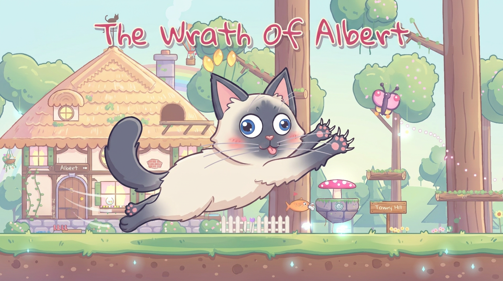
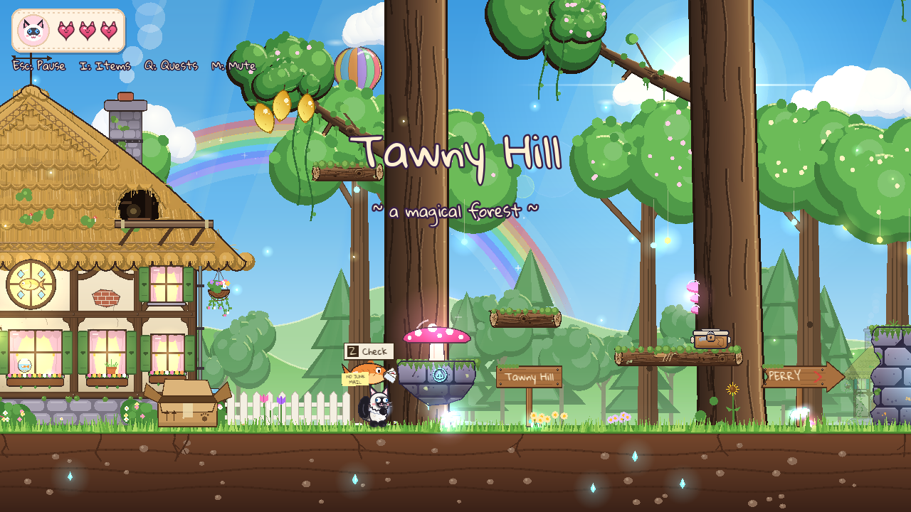
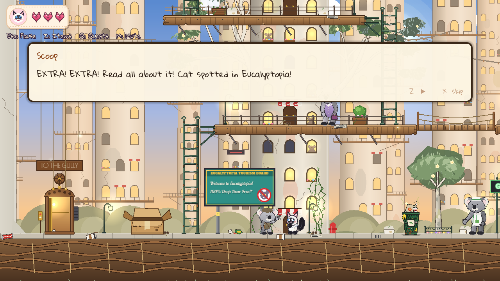
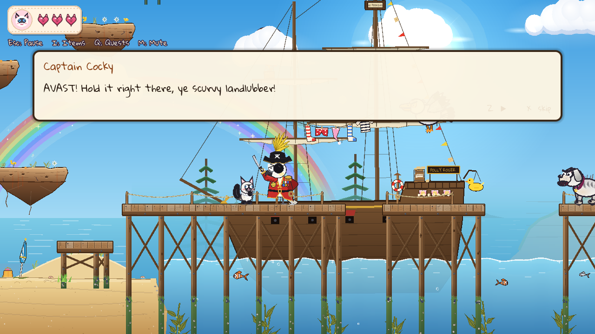
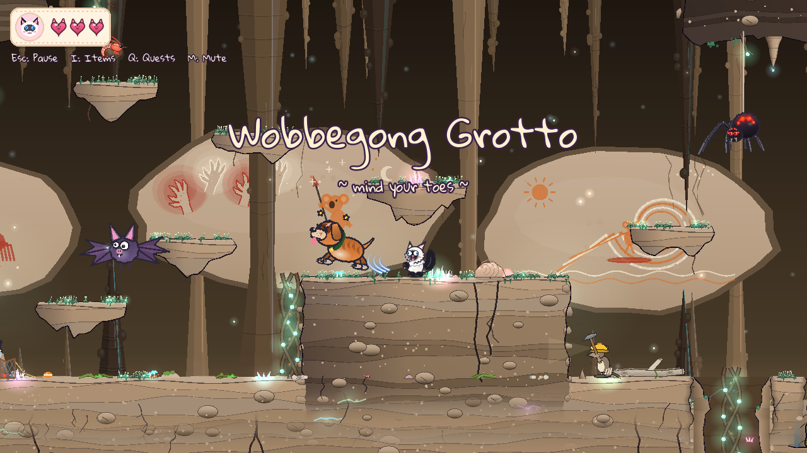
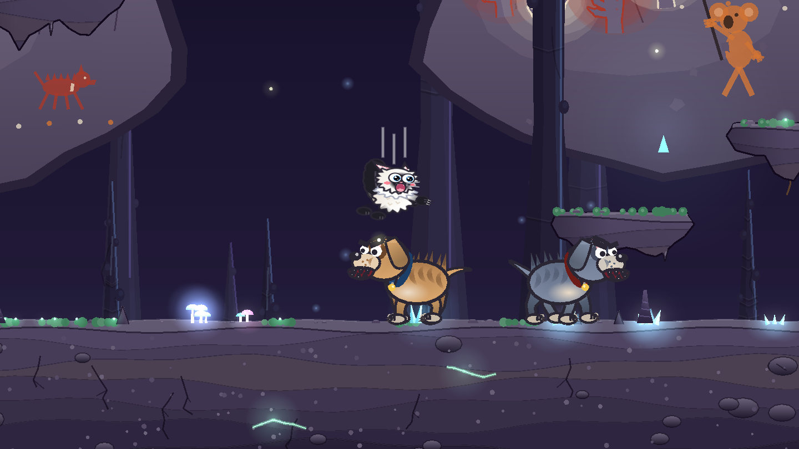
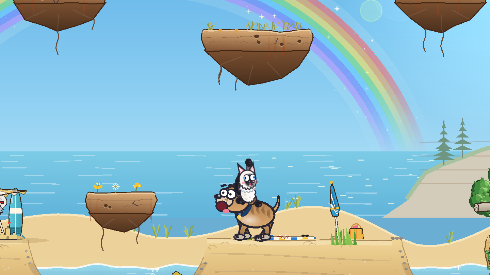
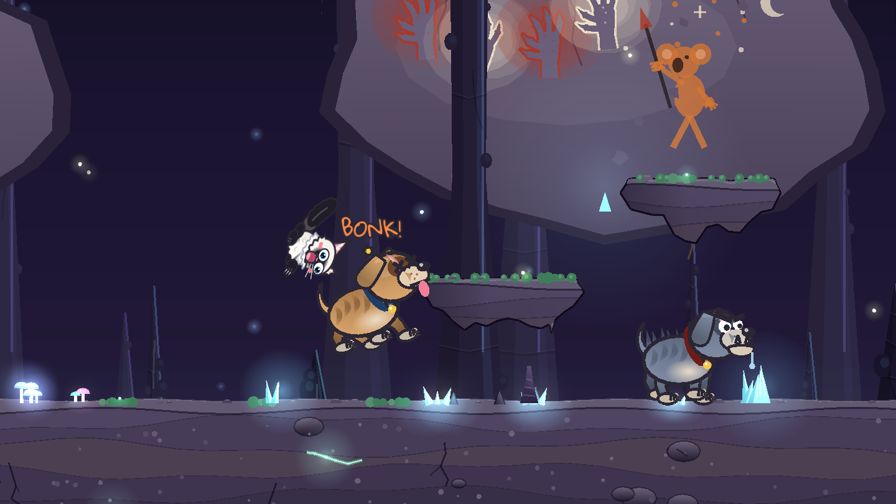
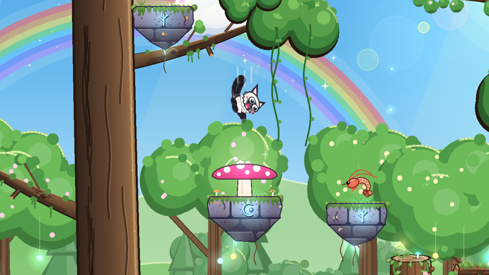

# The Wrath Of Albert (demo)

Albert is a fluffy ragdoll cat with no plans and no worries. Somebody keeps giving him jobs anyway.

> ### 🎮 Play it on itch.io: [https://jeriju.itch.io/the-wrath-of-albert](https://jeriju.itch.io/the-wrath-of-albert)
> ### 💬 Tell me what you thought: [the feedback form](https://docs.google.com/forms/d/1ZBK7EDi_RCsw9hShprB_aEUcb98xFOYwlcUMMu3qyR0/viewform) (2 minutes, no sign-in)

**The Wrath Of Albert** is a cute 2D platformer, inspired by *Tombi!*, set in an Australian bush full of koalas,
pademelons, magpies and an awful lot of dogs. Pounce on enemies, ride them, throw them, climb vines, swing on
branches, open eskies, help the locals with their problems, and nap in cardboard boxes to save.

This is an **early demo**. It runs from Tawny Hill, Albert's home, to the Suburban Wastes, where it ends.

  
  
  
  
  
  
  
  

## How to play

1. Go to **[Releases](../../releases)** (on the right of this page) and download **The Wrath Of Albert Demo.zip**.
2. Unzip it. Right-click it and choose **Extract All**.
3. Double-click **The Wrath Of Albert Demo.exe**.

Windows may say *"Windows protected your PC"*, because the game isn't from a big company. Click **More info**,
then **Run anyway**.

The demo is for **Windows** (64-bit). Nothing needs installing.

## Controls

Play with the keyboard or a controller. The game names the buttons the way your controller does: Xbox,
PlayStation or Nintendo. (The full list is in the game too: **Controls**, in the pause menu or the main menu's
Options.)

**Getting about**

| | Keyboard | Xbox | PlayStation |
|---|---|---|---|
| Move | Arrows or WASD | D-pad or left stick | D-pad or left stick |
| Jump (hold it to go higher) | Space | A | Cross |
| The Zoomies: hold while running (once learned) | Shift or C | LB or RB | L1 or R1 |
| Crouch, and crawl under low gaps | hold Down | hold Down | hold Down |
| Drop down through thin wood | Down + Space | Down + A | Down + Cross |
| Look up (standing still) | hold Up | hold Up | hold Up |
| Bounce higher off a mushroom | hold Space | hold A | hold Cross |

**Claws and chats**

| | Keyboard | Xbox | PlayStation |
|---|---|---|---|
| Claw swipe (holding Up: over his head) | X | B | Circle |
| Talk, use things, or meow | Z | X | Square |
| In a chat: next line / skip the rest | Z or Space / X | X or A / B | Square or Cross / Circle |

**Climbing**

| | Keyboard | Xbox | PlayStation |
|---|---|---|---|
| Catch a ledge: press toward it in mid-air | Left / Right | Left / Right | Left / Right |
| ...pull up onto it / let go | Up or Space / Down | Up or A / Down | Up or Cross / Down |
| Climb a vine, log or ladder (hold Up at it) | Up / Down | Up / Down | Up / Down |
| Grab a vine overhead: jump, then hold | Up | Up | Up |
| Swing round to its far side: press toward it | Left / Right | Left / Right | Left / Right |
| Kick off it | Space | A | Cross |

**Swing bars**

| | Keyboard | Xbox | PlayStation |
|---|---|---|---|
| Grab one: jump up into it | Space | A | Cross |
| Swing (and along a long bar) | Left / Right | Left / Right | Left / Right |
| Drop off / fly off with the swing | Down / Space | Down / A | Down / Cross |

**Riding enemies**

| | Keyboard | Xbox | PlayStation |
|---|---|---|---|
| Ride one: land on its back (it runs where it likes), then turn to aim | Left / Right | Left / Right | Left / Right |
| Lift it overhead | Space | A | Cross |
| Throw it (or, once it's lifted, jump again) | X | B | Circle |
| Throw it straight down (lifted, in mid-air) | hold Down + X | hold Down + B | hold Down + Circle |

**Cardboard boxes and eskies**

| | Keyboard | Xbox | PlayStation |
|---|---|---|---|
| Hop into a cardboard box (or just jump in) | Z beside it | X beside it | Square beside it |
| ...nap and save / not now | Z / X | X / B | Square / Circle |
| ...jump out | Space | A | Cross |
| Open an esky: sit on it, with its key | Space | A | Cross |
| ...hop off without opening it | Down + Space | Down + A | Down + Cross |

**Menus**

| | Keyboard | Xbox | PlayStation |
|---|---|---|---|
| In a menu: choose / back | Space or Z / X | A / B | Cross / Circle |
| The pause menu's tabs: the one before / after | Left / Right | LB / RB | L1 / R1 |
| Pause | Esc or P | Menu | Options |
| Items (put things on, or read them) | I or Tab | Y | Triangle |
| Quests | Q | View | Create |
| Mute / unmute | M | press in the right stick | press in the right stick |

## Saving

Jump into a **cardboard box** and take a nap to save. The game also saves by itself (the **Autosave**) every time
Albert goes somewhere new. There are three save files and the autosave, all picked from the main menu.

Saves are kept in `%APPDATA%\The Wrath Of Albert Demo` on your computer.

## Feedback

Bugs, ideas and opinions are all welcome, big or small, through
[the feedback form](https://docs.google.com/forms/d/1ZBK7EDi_RCsw9hShprB_aEUcb98xFOYwlcUMMu3qyR0/viewform).
It takes about 2 minutes, and you don't need to sign in.
